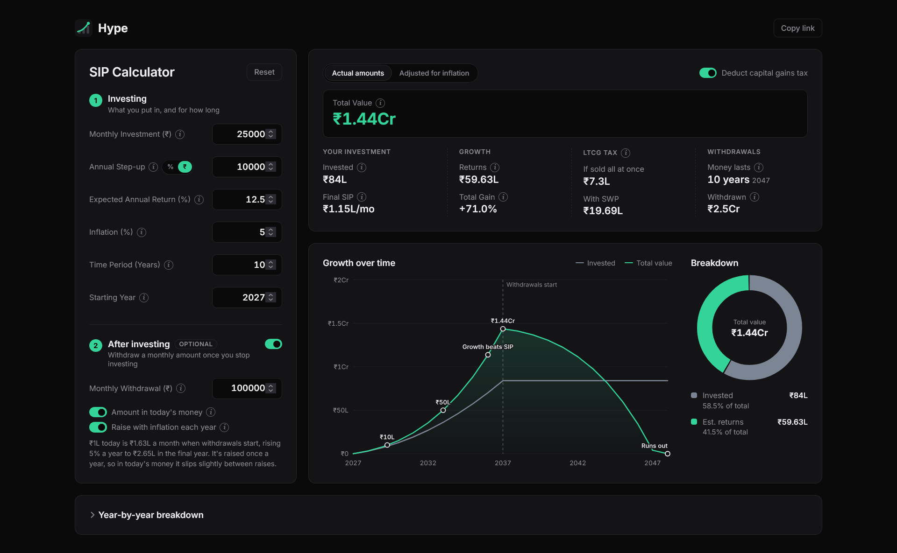

# Hype

A realistic calculator for SIPs (Systematic Investment Plans), for seeing what a monthly investment could grow into, and how long withdrawals from it could last.

- **Projects SIP growth** month by month, with an optional yearly step-up by percentage or fixed amount, showing the invested amount, returns and total value for each calendar year.
- **Adjusts for inflation and tax**, presenting every figure in actual or inflation-adjusted terms and deducting long-term capital gains tax.
- **Models withdrawals (SWP)** after the investing period, optionally rising with inflation, to show how long the corpus lasts and the total amount withdrawn.
